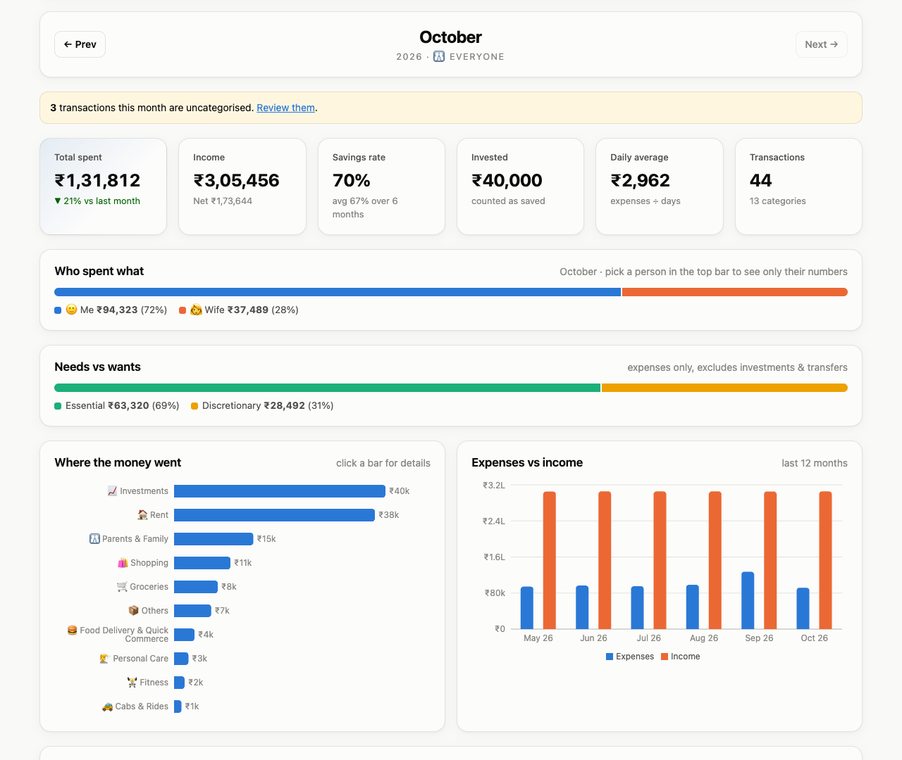

# Expense Calculator UI

React + Vite frontend for **[Expense Calculator](https://github.com/ashwaniagarwal226/expense-calculator)**. It covers multi-bank statement upload, automatic categorisation (keyword rules, UPI notes and Gemini AI), insights, savings tips and per-person profiles.



> 📖 **The full setup guide and the illustrated how-to-use walkthrough are in the [backend README](https://github.com/ashwaniagarwal226/expense-calculator#readme).**

## Quick start

The API must be running first; see the backend README.

```bash
npm install
npm run dev          # http://localhost:5173 (also prints a Network URL for your phone)
```

The UI calls the API at `http://<host you opened the UI from>:8081/api/expense/v1`. To point it somewhere else, copy `.env.example` to `.env.local` and set `VITE_API_BASE_URL`.

```bash
npm run build        # production build in dist/
npm run preview      # serve the build locally
```

## Structure

```
src/
├── api.js              REST client + ₹ formatting
├── profile.jsx         selected person (remembered per browser) + top-bar switcher
├── App.jsx             navigation and routes
├── index.css           light/dark design tokens
├── components/         UploadCard, charts (Recharts), NotFound
└── pages/              Dashboard, Transactions, SaveMore, Rules, Profiles
```
